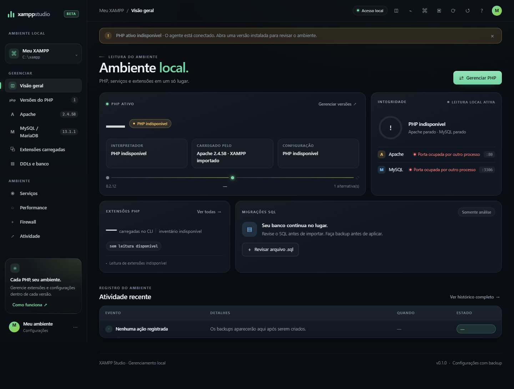
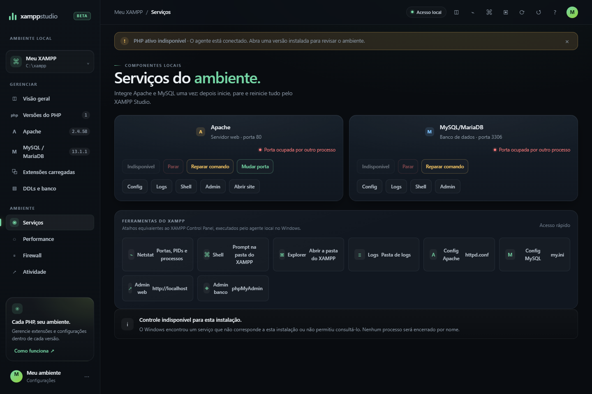
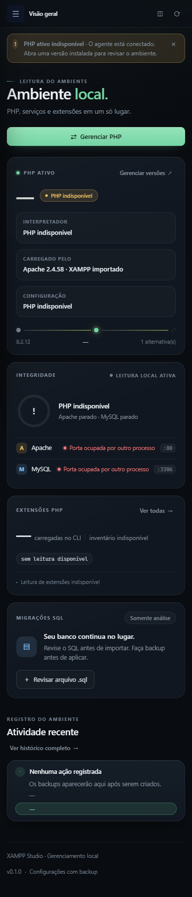

<div align="center">

# XAMPP Studio

**Gerencie Apache, PHP e MySQL/MariaDB no Windows com troca de versões sem susto.**

[](.github/workflows/ci.yml)
[](LICENSE)
[](#requisitos)
[](#requisitos)
[](docs/readiness-review.md)

</div>

> **English** — XAMPP Studio is a local, loopback-only manager for Apache, PHP and
> MySQL/MariaDB on Windows. It keeps multiple runtime versions side by side
> (`runtimes/`), verifies official builds by checksum (SHA-256/MD5), registers
> real Windows services, rewrites Apache/PHP config with automatic rollback
> when validation fails, and exposes everything through a dark, keyboard-friendly
> web UI served by a local Node agent. No CDN, no telemetry, MIT licensed.
> The rest of this README is in Brazilian Portuguese.

---

Gerenciador local para instalar, ativar e trocar componentes Windows do Apache, PHP e MySQL/MariaDB. Mantém versões separadas, cria backups, executa downloads em segundo plano e valida as configurações antes de aplicar trocas. O XAMPP pode ser importado como origem, mas deixa de ser um requisito operacional.



 

## Por que existe

Trocar a versão do PHP (ou do Apache) dentro de um XAMPP tradicional quebra o ambiente com frequência: DLLs incompatíveis, extensões que somem, caminhos absolutos espalhados pela configuração e nenhum caminho de volta. O Studio isola cada versão em `runtimes/`, valida **antes** de tocar em qualquer arquivo (tabelas PE, checksums, sintaxe do Apache) e mantém um backup com reversão automática quando a validação pós-troca falha. [Entenda a metodologia](#inventário-do-xampp).

## Requisitos

| | |
|---|---|
| Sistema | Windows 10/11 (o Studio gerencia serviços do Windows) |
| Node.js | 20 ou mais recente |
| PowerShell | 5.1+ (já incluído no Windows) |
| Opcional | Uma instalação existente do XAMPP, para importar como modo legado |

Sem dependências de runtime além do Node: o agente usa apenas módulos nativos e o CSS já vem compilado no repositório.

## Iniciar

No PowerShell, execute `./start.ps1` e abra `http://127.0.0.1:43197`. Não abra `index.html` como `file:///...`, porque essa origem não pode chamar o agente local. Use Ctrl+C no terminal para encerrar. As ações que exigem privilégio abrem uma solicitação UAC do Windows e são executadas por `scripts/windows-service-helper.ps1`; execute `./start.ps1 -AsAdmin` quando quiser evitar prompts repetidos. Alterações do Firewall ainda exigem uma instância administrativa.

Para usar outra instalação, defina `$env:XAMPP_ROOT='D:\xampp'` antes de iniciar. O agente só aceita conexões de loopback local.

## Serviços

Na primeira utilização, use **Integrar ao Studio** na página **Serviços** ou diretamente nos módulos **Apache** e **MySQL/MariaDB**. A ação registra o executável e a configuração selecionados como serviços do Windows (`Apache2.4` e `mysql` no modo legado). Quando o agente não está elevado, o Windows exibe um aviso UAC; aceitá-lo executa somente a operação confirmada na interface.

Depois da integração, **Liberar controles** pode conceder à conta local apenas as permissões de consultar, iniciar e parar o serviço. Isso evita novos avisos UAC durante o uso diário, mas não permite alterar o executável ou excluir o serviço. Se o UAC for cancelado, a tela explica que a operação não foi concluída e permite tentar novamente.

A leitura das portas identifica o processo proprietário. Se a porta 80 ou 3306 estiver ocupada por Docker, WSL ou outro programa, o Studio informa o conflito e não encerra esse processo. Se pertencer ao próprio runtime integrado, apresenta a migração única necessária para passar o controle ao serviço.

O **modo independente** usa `environment-state.json` como fonte de verdade, mantém sites, dados e logs em `workspace/`, gera a configuração do Apache e usa serviços próprios (`XAMPPStudio-Apache` e `XAMPPStudio-MySQL`). O modo legado continua compatível com `Apache2.4`, `mysql`, `properties.ini` e `httpd-xampp.conf` durante a migração.

## Ações do XAMPP Control Panel

O Studio reproduz o conjunto de ações do painel clássico do XAMPP, disponível nos módulos **Apache** e **MySQL/MariaDB**, na página **Serviços** e na barra superior:

| Ação | Comportamento |
|---|---|
| **Iniciar / Reiniciar** | Controla o serviço Windows e confere a porta local (80 ou 3306). O Apache só sobe depois de `httpd -t` retornar “Syntax OK”. |
| **Parar** | Encerra o serviço pelo Windows, com confirmação na tela. Nenhum arquivo de banco é removido. |
| **Config** | Abre o `httpd.conf`, o `my.ini` ou o `php.ini` do runtime ativo no Bloco de Notas. |
| **Logs** | Abre a pasta de logs do componente (ou do XAMPP) no Explorer. |
| **Shell** | Abre um prompt de comando na pasta do componente, com o título “XAMPP Studio Shell”. |
| **Admin** | Abre `http://localhost/` para o Apache e `http://localhost/phpmyadmin/` para o MySQL/MariaDB quando o phpMyAdmin está instalado. |
| **Netstat** | Mostra portas, estado, PID, processo e serviço das conexões ativas, destacando o que pertence ao Studio. |
| **Explorer** | Abre a pasta raiz do XAMPP configurado. |
| **Refresh** | Relê o estado do ambiente local. |

O Netstat é somente leitura: processos externos, como Docker ou WSL, são apenas identificados — nunca encerrados. As ações de janela (Shell, Explorer, Config, Logs e Admin) são executadas pelo agente local com allowlist de destinos: o navegador não envia caminhos arbitrários, apenas o nome da ação e o componente escolhido.

## Versões PHP, Apache e MySQL/MariaDB

- O catálogo PHP consulta builds oficiais para Windows acima da versão ativa e mantém arquitetura e modo TS/NTS compatíveis. O ZIP passa por validação SHA-256 e é extraído em `runtimes/`.
- Ao preparar outro PHP, o Studio leva as diretivas de extensões do `php.ini` atual quando a DLL existe no novo pacote oficial. Diretivas sem DLL compatível são comentadas para evitar erros de inicialização e aparecem como pendências daquela versão.
- As DLLs em uso ficam registradas em `dll-registry.json`: extensões ativas do `php.ini`, `php*ts.dll`, `php*apache2_4.dll` e arquivos `LoadFile` do `httpd-xampp.conf`. Clicar em uma versão em **Versões do PHP** abre a configuração daquele runtime, com abas **Resumo**, **DLLs** e **Variáveis**. A aba DLLs lista as dependências com busca, estado (presente/ausente), cópia do inventário e atualização do registro.
- Antes de alterar qualquer arquivo, a configuração da versão compara o runtime de destino com esse registro. Se uma única DLL exigida não existir no novo PHP, a troca é **bloqueada** e a lista de ausentes é exibida; a versão atual continua intacta. O mesmo bloqueio é repetido no agente local, não apenas na interface.
- Depois da verificação, a ativação garante no `php.ini` de destino as extensões exigidas pelo ambiente registrado (por exemplo, `php_redis.dll` e `php_apcu.dll` quando presentes no novo pacote), evitando que a nova versão suba com uma extensão desativada. O `php.ini` também passa a apontar o `error_log` e o `openssl.cafile` para as pastas do runtime e do Apache realmente em uso — sem isso os erros do PHP sumiam e a verificação de certificados do `curl` dependia do XAMPP antigo.
- A ativação valida o PHP e a configuração Apache. É possível selecionar junto um Apache preparado. A troca cria backup dos arquivos e valida `httpd -t`; se o serviço não iniciar ou a porta não responder, o Studio restaura a configuração anterior.
- O catálogo Apache lista builds Windows do Apache Lounge, fornecedor terceiro. O pacote e o checksum publicados pelo fornecedor são conferidos. Um runtime fica isolado até o usuário ativá-lo junto com o PHP atual.
- A lista de versões disponíveis acompanha a versão ativa do ambiente. O PHP e o Apache antigos permanecem disponíveis para voltar.
- O módulo **Apache** fica na navegação principal. O download, a verificação do SHA-256 e a extração rodam como uma operação assíncrona; a ativação gera `xampp-studio-httpd.conf`, valida `httpd -t` e só então troca o serviço.
- O módulo **MySQL / MariaDB** consulta simultaneamente os arquivos oficiais do MySQL Community e do MariaDB. MySQL usa o MD5 publicado pela Oracle; MariaDB usa o SHA-256 publicado no archive oficial. O pacote é extraído em `runtimes/`, recebe um `my.ini` próprio e um diretório de dados isolado em `workspace/mysql/data/`. A inicialização cria uma senha aleatória para `root` e a guarda em `workspace/mysql/credentials/`; nenhum banco é iniciado com senha vazia.
- A troca do banco altera somente o comando do serviço integrado e mantém o runtime anterior disponível. Se o serviço não reiniciar ou a porta 3306 não responder, o comando anterior e o estado do ambiente são restaurados.

Os backups, runtimes e workspace são gravados dentro deste projeto (e ficam fora do controle de versão — veja o `.gitignore`). A ativação de serviços e de runtimes altera o ambiente somente após confirmação na interface, cria backup e executa a reversão automática quando a validação falha.

## Compatibilidade PHP × Apache no Windows

O Windows resolve DLLs pelo **nome do arquivo**, e o Apache já carrega `libssl-3-x64.dll` e `libcrypto-3-x64.dll` (OpenSSL) por causa do `mod_ssl`. Quando o PHP carrega uma extensão que também depende do OpenSSL — `curl`, por exemplo — o processo passa a usar a cópia do Apache. Se a versão do OpenSSL do Apache for antiga, a extensão falha ao carregar (`Não foi possível encontrar o procedimento especificado`, erro 127) e `curl_init()` simplesmente não existe, mesmo com `extension=curl` no `php.ini`.

O Studio trata isso em quatro camadas:

- **Verificação prévia.** Antes de trocar, o agente lê a tabela de importações e a de exportações das DLLs do runtime PHP (`lib/pe-imports.cjs`) e compara os símbolos exigidos com os que a biblioteca carregada pelo Apache oferece. A incompatibilidade aparece na lista de versões, com o detalhe de cada símbolo faltante, e a troca é recusada antes de qualquer alteração.
- **Dependências carregadas explicitamente.** As DLLs nativas de que o PHP precisa, mas que o Apache não carrega (`brotlidec`, `brotlicommon`, `libssh2`, `nghttp2`…), são declaradas com `LoadFile` na configuração gerada. O XAMPP original resolvia isso por outro caminho: o `xampp_shell.bat` colocava `C:\xampp\php` no `PATH` do processo. Como serviço do Windows não existe esse `PATH`, o `LoadFile` substitui essa herança.
- **Certificado próprio no runtime isolado.** O certificado que acompanha o XAMPP usa RSA de 1024 bits e SHA1. O OpenSSL 3.5 do Apache 2.4.69 recusa a configuração (`ee key too small`) e o serviço sobe e cai em seguida. Por isso o runtime isolado recebe um certificado autoassinado de 2048 bits gerado pelo `openssl.exe` que acompanha o próprio build.
- **Guarda pós-troca.** Depois do reinício, o Studio lê o `error.log` do Apache e compara com o tamanho anterior. Se alguma extensão não carregou no contexto web, a troca é revertida e o ambiente volta ao runtime anterior.

Na prática, PHP 8.5.12 exige um Apache com OpenSSL 3.2 ou mais novo — o Apache Lounge 2.4.69 (OpenSSL 3.5.9) atende ao requisito. PHP 8.2.12 funciona tanto com o Apache 2.4.58 (OpenSSL 3.1.3) quanto com o 2.4.69.

## Serviço do Windows: comando de inicialização

O serviço guarda o executável e a configuração em `ImagePath`, no registro. Dois detalhes do Windows quebram a troca de runtime e são tratados pelo Studio:

- O SCM recusa um `ImagePath` com **espaço inicial** (`StartService FALHA 87: Parâmetro incorreto`). Por isso o comando é gravado sem espaço e conferido logo depois de gravado.
- Alterar o registro **não avisa o SCM**: o Windows continua usando o comando antigo e o serviço falha ao subir. Por isso a reescrita passa pelo `sc.exe config`, que notifica o gerenciador, com reserva pela escrita direta e nova notificação.

A ação **Reparar comando**, disponível nos módulos Apache e MySQL/MariaDB e na página **Serviços**, reaplica o comando do runtime ativo, valida a configuração do Apache e reinicia o serviço. Ela resolve o sintoma “troquei a versão e o serviço não sobe mais”.

## Extensões e bancos

Em **Versões do PHP → Configurar → DLLs**, pesquise, por exemplo, `ext-opentelemetry`, `opentelemetry` ou `php_opentelemetry.dll`. O PHP aberto é o destino fixo da consulta, do download e da instalação. Para mudar de destino, volte à lista e abra outra versão. A busca normaliza os nomes, consulta diretamente o PECL e combina os resultados com pacotes `php-ext` do Packagist. A consulta direta continua disponível se o Packagist falhar. Pacotes PIE também mantêm a opção de preparar um comando para revisão.

Clique em **Ver DLLs compatíveis** para consultar as oito versões estáveis mais recentes publicadas no PECL e seus builds Windows em `https://downloads.php.net/~windows/pecl/releases/`. Só builds com versão PHP, TS/NTS, compilador e arquitetura correspondentes recebem botões de download e instalação. Quando não há build compatível, o painel informa isso. A seção **DLLs baixadas** pertence ao caminho exato daquele PHP, inclusive quando duas instalações têm o mesmo número de versão. O manifesto persiste `phpRoot`; downloads antigos usam o destino registrado na operação quando disponível. API: `GET /api/extensions/downloads?phpRoot=<caminho>` lista somente os downloads desse runtime.

**Baixar DLL** baixa o ZIP oficial, extrai e confere a arquitetura PE da DLL. Salva a DLL, o ZIP original e um manifesto com origem e SHA-256 em `downloads/extensions/<id>/`, sem alterar o runtime ou o `php.ini`. O navegador recebe a DLL; o botão **Salvar ZIP completo** preserva também documentação e eventuais dependências auxiliares. Os hashes são calculados localmente para registro, sem alegação de comparação com checksum publicado. API: `POST /api/extensions/download` cria a operação e `GET /api/extensions/downloads/<id>/<arquivo>` entrega o resultado.

O botão **Instalar e configurar** executa o fluxo completo em segundo plano: pesquisa → seleciona build compatível → baixa → valida a arquitetura PE → extrai em staging → cria backup → copia a DLL → atualiza o `php.ini` → inicia o PHP para confirmar o módulo. Qualquer falha restaura o `php.ini` e remove a DLL recem-copiada. O hash SHA-256 do pacote e do build selecionado ficam no registro da operação.

Arquivos SQL são analisados localmente para apontar operações de risco. O Studio ainda não executa DDL/SQL nem cria backups completos dos bancos de dados.

## Operações assíncronas

Downloads longos e preparações que podem falhar não ocupam uma requisição HTTP. O agente cria uma operação em `jobs/job-state.json`, mantém etapas e progresso, e a interface acompanha o trabalho por polling. A API oferece `GET /api/jobs`, `GET /api/jobs/:id` e endpoints de criação específicos para extensões PECL, Apache e MySQL/MariaDB. Uma operação interrompida pelo reinício do agente é marcada como falha em vez de ficar indefinidamente em execução.

Endpoints de controle: `GET /api/status`, `POST /api/services/integrate`, `POST /api/services/restart`, `POST /api/services/stop`, `POST /api/services/grant-control`, `POST /api/services/repair`, `GET /api/diagnostics`, `GET /api/diagnostics/export`, `GET /api/netstat` e `POST /api/xampp/action` (`shell`, `explorer`, `logs`, `config` ou `admin`, sempre com allowlist).

## Diagnóstico e testes

O botão **◫** na barra superior exporta um diagnóstico completo em Markdown: versões em uso, SHA-256 dos executáveis, serviço do Windows com o `ImagePath` gravado, donos das portas 80 e 3306, a matriz de compatibilidade PHP × Apache, o certificado TLS do runtime (tamanho da chave, titular e validade), as diretivas relevantes do `php.ini`, as últimas operações e o fim do log de erros do Apache e do MySQL. A leitura é local e não altera nada; o mesmo conteúdo está em `GET /api/diagnostics`.

A suíte de testes protege as regras que quebraram o ambiente durante a troca de versão. Execute com:

```powershell
node tests/run-tests.cjs
```

Ela cobre a leitura das tabelas PE, a detecção de conflito de símbolos entre PHP e Apache (inclusive o caso real do PHP 8.5.12 com o OpenSSL 3.1.3 do Apache 2.4.58), a reescrita do `httpd-xampp.conf` — inclusive a trava que impede a troca de `C:/xampp/php` dentro de `C:/xampp/phpMyAdmin` —, a lista de DLLs que precisam de `LoadFile`, a leitura das falhas do `error.log` e as regras do comando do serviço do Windows. Os testes usam os binários da instalação local quando existem e não alteram o ambiente.

O GitHub Actions executa a suíte automaticamente a cada push e pull request (veja [.github/workflows/ci.yml](.github/workflows/ci.yml)).

## Performance, PHP e firewall

- **Performance** divide o orçamento configurado entre Apache/PHP e MySQL/MariaDB. Os controles se recalibram para somar 100% do orçamento dos serviços e reservam 20% da memória estimada para o Windows. O Studio traduz essa distribuição em concorrência do Apache, `memory_limit` do PHP, cache InnoDB e conexões. Isso não impõe um teto exato de CPU por processo. Aplicar cria backup, valida Apache e MySQL e reinicia somente serviços que já estavam rodando sob controle do Studio; uma falha restaura os arquivos anteriores.
- **Variáveis do PHP** fica na configuração de cada versão e permite pesquisar e editar um conjunto limitado de diretivas conhecidas, agrupadas por erros, execução, envios, OPcache e fuso horário. São alteradas apenas as opções tocadas pelo usuário. Caminhos de log precisam permanecer dentro do XAMPP ou deste projeto. O php.ini recebe backup antes de salvar e é validado pelo `php.exe` da própria versão; o Apache é reiniciado apenas quando a versão editada é a ativa e já está rodando sob o Studio.
- **Firewall** lê as linhas que já existirem em `apache/logs/access.log` e no log `pfirewall.log` do Windows, quando disponível. A lista é limitada às 500 linhas mais recentes. O Apache registra método e caminho; essas fontes de rede não contêm o corpo HTTP.
- A captura filtrada de corpo é **opcional** e desligada por padrão. Se ativada, um `auto_prepend_file` validado pelo PHP registra apenas JSON e formulários urlencoded até 16 KB para sites PHP deste XAMPP. Campos com nomes de senha, token, segredo, chave, cookie, sessão, CSRF ou credencial são ocultados; valores longos são limitados, e uploads e corpos binários não são salvos. O log rotativo fica em `logs/request-bodies.jsonl` dentro deste projeto. Desativar remove somente a diretiva e o script gerados pelo Studio; os registros já existentes permanecem no disco. “Raw” mostra a linha original filtrada para essas entradas.
- Bloquear um IP cria uma regra de entrada no Firewall do Windows identificada pelo Studio. O botão de desbloqueio remove somente regras que o próprio projeto registrou. Essas alterações exigem iniciar `start.ps1 -AsAdmin`.
- A opção Cloudflare busca as faixas IPv4 e IPv6 publicadas pela Cloudflare no momento da prévia e novamente antes da aplicação. Ela só prossegue quando todos os perfis do Firewall estão ativos e bloqueiam conexões de entrada por padrão, e quando regras existentes não abrem HTTP/HTTPS de forma ampla. Regras TCP locais específicas para 80/443 são desativadas e guardadas para restauração; regras ambíguas ou gerenciadas por política bloqueiam a aplicação. A remoção restaura as regras desativadas. O Studio não altera o padrão geral do Firewall.

## Inventário do XAMPP

A análise orientada por evidências (metodologia REA) mapeou os componentes usados na troca de versão:

- **Apache**: `apache/bin/httpd.exe`, `conf/httpd.conf`, `conf/extra/httpd-xampp.conf`, serviço `Apache2.4`, porta 80. O módulo PHP é carregado por `LoadModule php_module` e os runtimes por `LoadFile`.
- **PHP**: `php/php.exe`, `php/php.ini`, `php/ext/*.dll`; TS/NTS e arquitetura precisam coincidir com o Apache. O `properties.ini` guarda `php_binary_directory` e `base_stack_version`.
- **MySQL/MariaDB**: `mysql/bin/mysqld.exe`, `mysql/bin/my.ini`, serviço `mysql`, porta 3306.
- **Ações controladas**: inventariar portas e serviços, integrar/registrar serviços do Windows, iniciar/reiniciar, validar `httpd -t`, criar backup, migrar `php.ini` e alternar runtime PHP/Apache com reversão.
- **Regra da troca de PHP**: registrar as DLLs ativas, verificar o destino antes de escrever arquivos e impedir a ativação quando o conjunto não estiver completo.

## Porta do Apache

O Apache escuta na porta declarada no `httpd` em uso — o Studio lê esse valor em vez de assumir a 80. Quando outro programa ocupa a porta (Docker, WSL, IIS), o botão **Mudar porta** na página de Serviços migra o runtime:

1. o `httpd.conf` atual é copiado para `backups/switch-*`;
2. a diretiva `Listen` e o `ServerName` são reescritos para a nova porta;
3. a configuração passa pelo `httpd -t`;
4. o serviço é reiniciado e a porta nova precisa responder;
5. qualquer falha restaura o arquivo anterior e reinicia o Apache na configuração antiga.

O diagnóstico e a tela de status passam a mostrar a porta real e distinguem três situações que antes apareciam iguais: serviço em execução, serviço parado e porta ocupada por um processo que não é do Studio.

## Interface

A interface usa Tailwind CSS compilado localmente junto do design system do Studio. O arquivo servido é `styles.css`; edite `src/styles.css`, `src/tailwind.css` e os templates, depois execute `npm ci` e `npm run build:css`. O CSS gerado já acompanha o projeto: abrir o painel não depende de CDN nem exige instalar pacotes. As decisões:

- **Superfícies em camadas** com gradiente sutil no topo, borda translúcida e brilho interno (`inset 0 1px 0`), para que os cartões pareçam iluminados e não desenhados;
- **Visão geral compacta**: PHP e integridade na primeira linha, extensões e revisão SQL na segunda; as telas se reorganizam em tablet e celular, com navegação lateral recolhível;
- **Movimento com mola** (`cubic-bezier(0.16, 1, 0.3, 1)`) em botões, cartões e modais, com `prefers-reduced-motion` respeitado;
- **Estados explícitos**: skeletons com brilho durante a leitura, chips por situação (ok, aviso, bloqueado), toasts com saída animada e modal com foco movido para a primeira ação;
- **Acessibilidade**: foco visível em tudo, `aria-current` na navegação, `aria-live` nos toasts, contraste verificado nos textos secundários.

Atalhos de teclado: `1`–`6` navegam entre as telas, `R` relê o ambiente, `D` exporta o diagnóstico e `?` abre a ajuda. Os atalhos são suspensos durante edição de campos e com um diálogo aberto. Os diálogos contêm o foco e o devolvem ao controle anterior ao fechar.

Validação: `npm test` executa a suíte original e as verificações adicionais de destinos Admin e inicialização. Com o Studio aberto, `playwright-cli run-code --filename=tests/ui-smoke.js` verifica as 11 telas em 1440, 768 e 390 pixels, filtros e diálogos. `tests/ui-states.js` verifica desconexão, reconexão, dados locais inválidos e teclado no menu móvel. Esses testes não iniciam/paralisam serviços nem aplicam configurações. Veja a avaliação e seus limites em [docs/readiness-review.md](docs/readiness-review.md).

## Organização do código

| Arquivo | Responsabilidade |
|---|---|
| `server.cjs` | rotas HTTP, orquestração das operações e arquivo estático |
| `lib/runtime-state.cjs` | estado do ambiente, seleção de runtime e configuração efetiva |
| `lib/services.cjs` | serviços do Windows, portas, helper com UAC e ações de iniciar/parar/reparar |
| `lib/php-compat.cjs` | compatibilidade PHP × Apache, config do Apache e reescrita do `httpd-xampp.conf` |
| `lib/apache-config.cjs` | leitura da porta real do Apache e reescrita de `Listen`/`ServerName` |
| `lib/service-command.cjs` | normalização e comparação do `ImagePath` do serviço |
| `lib/diagnostics.cjs` | coleta e renderização do diagnóstico exportável |
| `lib/pe-imports.cjs` | leitura das tabelas PE de importação e exportação |
| `lib/jobs.cjs` | fila de operações assíncronas persistida em disco |
| `lib/database-catalog.cjs` | catálogo de MySQL e MariaDB |
| `lib/extension-catalog.cjs` | pesquisa de extensões no Packagist/PECL e leitura dos builds Windows compatíveis |
| `lib/extension-downloads.cjs` | inventário de downloads de extensões por runtime PHP |
| `scripts/windows-service-helper.ps1` | operações de serviço executadas com elevação UAC |
| `scripts/change-apache-port.cjs` | migração de porta pela linha de comando, com backup e reversão |
| `scripts/build-css.cjs` | combina o CSS compilado e o tema em `styles.css` |
| `js/core.js` | estado compartilhado, armazenamento local, toasts, modal e skeletons |
| `js/api.js` | acesso ao agente local com tratamento de erro único |
| `js/app.js` | telas, renderizações e atalhos |
| `src/styles.css`, `src/tailwind.css` | fontes do tema escuro e dos componentes Tailwind |
| `tests/run-tests.cjs` | 19 verificações automatizadas sem efeito no ambiente |
| `tests/extension-catalog.cjs` | testes do catálogo de extensões (Packagist/PECL) |
| `tests/admin-targets.cjs` | destinos Admin por componente com porta real |
| `tests/start-safety.ps1` | mata um processo só quando é a própria instância do Studio |
| `tests/ui-smoke.js`, `tests/ui-states.js`, `tests/ui-extension-catalog.js`, `tests/ui-extension-scope.js` | percurso de interface no navegador (playwright-cli) |
| `.github/workflows/ci.yml` | CI no GitHub Actions (Windows) |

## Privacidade e dados

O Studio roda inteiramente na sua máquina: o agente escuta só em `127.0.0.1`, não envia telemetria e consulta apenas as fontes oficiais dos componentes (windows.php.net, Apache Lounge, MySQL, MariaDB, Packagist, PECL e as faixas IP da Cloudflare) quando você pede um catálogo. Credenciais de banco geradas ficam em `workspace/mysql/credentials/`. Estado, backups, runtimes baixados, dados de bancos e logs ficam **fora do Git** (`.gitignore`) — inclusive os dumps SQL que você importar nunca são versionados.

## Contribuindo

Issues e PRs são bem-vindos — leia o [CONTRIBUTING.md](CONTRIBUTING.md) para requisitos de teste e as regras de segurança do código. Vulnerabilidades: siga a política em [SECURITY.md](SECURITY.md) (não abra issue pública).

## Licença

Distribuído sob a [licença MIT](LICENSE). O Apache, o PHP e o MySQL/MariaDB são marcas e softwares de seus respectivos proprietários e fornecedores (Apache Lounge, php.net, Oracle, MariaDB Foundation); este projeto não é afiliado a eles nem ao XAMPP/Apache Friends.

## Referência

O REA ([morluto/rea](https://github.com/morluto/rea)) foi usado como referência de investigação guiada por evidências. Ele não é dependência do XAMPP Studio.
